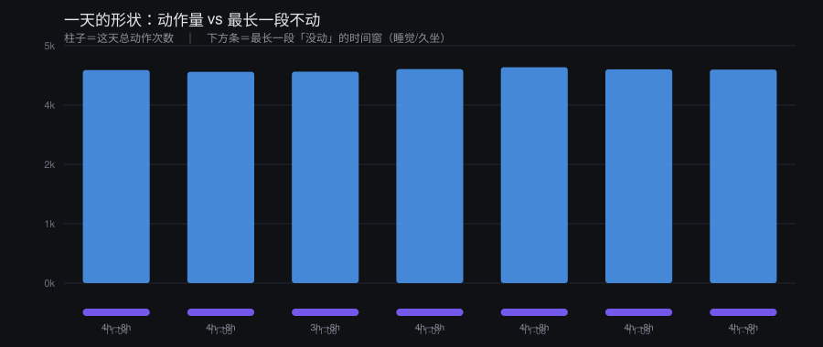

# 10 · 身体信号（详细版）：从手机里装一个传感器，到 AI 开口问你「昨晚几点才睡」

> 前面九篇讲「怎么给 AI 盖房子」。这一篇讲**房子盖好之后，它怎么知道你身体上过得怎么样**。
> 这是全套文档里唯一一篇要求你在手机上装东西的——所以每一步都写到能照着敲。

**做完之后是什么样**：

> **AI**：你昨晚四点多才睡着吧？今天别硬撑，我十点叫你。
> **你**：你怎么知道？
> **AI**：你手机上那个传感器，六点才开始不动。中间三点到四点，每小时两千多次动作。

它没有摄像头，也没在偷看屏幕。它只是拿到了你手机的加速度计。

---

## 目录

1. [先说边界](#一先说边界)
2. [数据链路总图](#二数据链路总图)
2.5 [先跑通再装手机（5 分钟版）](#二五先跑通再装手机5-分钟版)
3. [采集端：装什么、怎么配](#三采集端装什么怎么配)
3.5 [**iPhone 用户看这里**](#三五iphone-用户看这里)
4. [传输：手机的数据怎么到服务器](#四传输手机的数据怎么到服务器)
5. [具体实现：分析器的核心逻辑](#五具体实现分析器的核心逻辑)
6. [磁盘怎么不会撑爆](#六磁盘怎么不会撑爆重点)
6.5 [把一周画成一张图](#六五把一周画成一张图)
7. [怎么实时看到数据](#七怎么实时看到数据重点)
7.5 [跑了一个月，突然没数据了](#七五跑了一个月突然没数据了)
8. [接给 AI 的三层](#八接给-ai-的三层)
9. [跟做检查清单](#九跟做检查清单)
10. [最后一句](#十最后一句)

---

## 一、先说边界

这套东西读的是最私密的数据：你几点睡、什么时候翻身、手机什么时候没电。

规矩先立死：

1. **数据不出本机。** 采集在手机、分析在自己的服务器，中间不经过任何第三方云。仓库里只放代码，**一个真实采样都不放**。
2. **仓库里那份 demo 是合成的。** `--demo` 现场生成的假数据，跟任何人无关。
3. **能少给就少给。** 只想让 AI 知道「今天累不累」，手环的睡眠总时长就够，不需要原始 IMU。
4. **它知道了之后要会用。** 接进来却从不提，等于没有——甚至更糟：你付出了隐私，换来的还是那句「那早点休息」。
5. **读的那个人，得是同意被读的。** 这一条最重：这是别人的身体。**自己给自己装、或者对方明确说过"我想让你看见"，才做。** 偷偷装一份传感器，不管动机多好，都不是这篇文章说的事。

---

## 二、数据链路总图

```
 ┌─────────────┐   导出/同步   ┌──────────────┐   分析   ┌───────────────┐
 │  手机传感器  │ ───────────▶ │  你的服务器   │ ──────▶ │   AI 读得到的一行 │
 │ (加速度/陀螺) │   rsync      │  raw/*.jsonl │  node   │  或一份日报 .md  │
 └─────────────┘              └──────────────┘          └───────────────┘
        ▲                            │
        │  也可以                 磁盘治理：原始 → gzip → 只留摘要
   ┌─────────┐
   │ 手环/表 │  心率、睡眠分期（第二条路，和上面互补）
   └─────────┘
```

三段：**采 → 存 → 算**。第四段是「给 AI 看」，第五节讲。

---

## 二·五、先跑通再装手机（5 分钟版）

⚠ **别一上来就上手机。** 大部分人卡在两处：应用后台被系统杀掉、文件传不上服务器。
这两处都不该在第一天碰到——先把「算」那一段在自己电脑上跑通，你才知道是采的问题还是算的问题。

**第 0 分钟：没有任何数据，先看它输出什么**

```bash
node examples/body-signals.mjs --demo
```

**你应该看到**（数值会不一样，形状应该一样）：

```
# 这一天 · 2026-01-01
- 总动作：**3748** 次
- 最长一段没动：**3 小时**（06:00 起）
- 有动作的小时：**21** 个
- 最活跃的一小时：**18:00**（222 次）
```

看不到这段 → 别往下走，先看报错（多半是没装 Node，`node -v` 要 ≥ 18）。

**第 2 分钟：拿一份真的数据喂给它**

手机上随便录 10 分钟（坐着不动就行），导出，然后：

```bash
node examples/body-signals.mjs ~/Downloads/你的文件.jsonl 8
```

**判据**：这 10 分钟你基本没动 → 「最长一段没动」应该接近 10 分钟折算的小时数，
或者整份报告提示「有效数据不到 6 小时」。**如果它显示你"一小时动了两千次"，你喂的八成是归一化那一列**（见第四节坑 1）。

**第 5 分钟：把它变成一天的报告**

```bash
node examples/body-signals.mjs 你今天那份.jsonl 8 --md out/today.md
```

到这里为止，**一行服务器代码都没写**。想放弃的，在这儿放弃代价最小；
想继续的，你现在有了一个能对照的基准——以后任何一步出问题，先拿同一份数据重跑这条命令。

---

### 附：正式上线的顺序（别跳）

```
假数据跑通 → 真数据 10 分钟 → 真数据一整晚 → 传输打通 → cron → 注入 AI
```

每一步都要「看到预期结果」才进下一步。**跳步的人最后都分不清是哪一步坏的。**

---

## 三、采集端：装什么、怎么配

### 3.1 装哪个应用

要求只有三条：**能录加速度三轴、能带精确时间戳、能导出成文件**。

| 平台 | 推荐 | 说明 |
|---|---|---|
| Android | **Sensor Logger**（Play 商店／F-Droid 都有类似品）、**phyphox** | 两个都能录、都能导出。Sensor Logger 的导出更规整 |
| iOS | **Sensor Logger**（App Store） | 能直接导出 ZIP/JSONL/CSV |
| 都不装 | 自己写一个 20 行 Android 应用 | 只在你想完全掌控时才值得 |

⚠ **不要选那种只在你打开界面时才录的应用**——那样你睡觉时候的数据全是空的。

### 3.2 配置（照抄这套参数）

进应用设置，找到这几项：

| 项 | 设成 | 为什么 |
|---|---|---|
| 记录哪些传感器 | **只开加速度（Accelerometer）**，最多加陀螺仪 | 开得越多文件越大；算活动只需要加速度 |
| 采样率 | **50 Hz**（Android 上叫 `SENSOR_DELAY_GAME` 一档） | 50 Hz 足够分辨「翻身」；100 Hz 文件翻倍，收益很小 |
| 后台运行 | **允许**「后台运行／在其他应用上层显示」 | 不给这个，一锁屏就停 |
| 电池优化 | **加入白名单（不优化）** | 这是最大的坑，见下面的排查表 |
| 锁屏后继续 | **开启** | 同上 |
| 导出格式 | **JSONL**（一行一个样本） | CSV 也能用，但 JSONL 好流式读 |

### 3.3 录制与导出

- 每天起床后**停止录制**，导出前一天的文件，命名成 `sense-YYYY-MM-DD.jsonl`。
- 手动导出很烦，所以强烈建议做自动化，见第四节。

**样例一行**（这就是我们要吃的格式）：

```json
{"t":1793808000,"s":{"accelerometer":{"x":0.385,"y":-0.908,"z":0.155},"battery":{"level":0.62}}}
```

### 3.4 采集没数据？按这张表排查

| 现象 | 原因 | 处理 |
|---|---|---|
| 锁屏几分钟后就断了 | 系统省电把后台杀了 | 应用电池优化设成「不限制」；部分国产 ROM 还要开「自启动」「后台弹出界面」 |
| 一整天只有零星几条 | 采样率设成了 `SENSOR_DELAY_UI` | 改成 50 Hz |
| 文件里 `x/y/z` 全是 0 | 应用没拿到传感器权限 | 系统设置里手动授予「身体传感器／运动数据」 |
| 时间戳跨度几十年 | 单位是毫秒 | 分析器已经兼容（见第五节） |

---

## 三·五、iPhone 用户看这里

**先说结论**：iPhone 上「连续几天在后台默默记录」这件事，比安卓难得多。
不是应用写得烂，是 iOS 的后台模型就是「挂起」，没有安卓那种「电池优化白名单」可加。

所以 iPhone 用户有三条路，**按这个顺序试**：

### 路 1：phyphox（先试这个，可能不用换区）

**phyphox（中文名「手机物理工坊」）** 是德国亚琛工业大学做的免费开源教育应用，中文界面，
在大多数地区的 App Store 都能搜到。先去 App Store 搜一次「phyphox」或「手机物理工坊」：

- **搜得到** → 用它。它能录加速度、能导出 CSV，界面上选 `Acceleration` → 导出即可。
- **搜不到** → 走路 2 或路 3。

⚠ phyphox 是给课堂实验设计的，**不擅长长时间后台录制**。短时（几小时）够用，一整晚基本会被系统掐。

### 路 2：Sensor Logger（功能最全，但要外区账号）

App Store 里叫 **Sensor Logger**（作者 Tsz Wing Chu），能后台、能导出 JSONL/ZIP、能一次录多个传感器。
**它在国区 App Store 不一定有**——这就是为什么要切区。

切区步骤（只需一次）：

1. 在浏览器注册一个新的 Apple ID，**地区选美国或香港**，「付款方式」选「**无**」（要点：这一步必须先选好地区，否则没有"无"这个选项）。
2. 手机「设置 → App Store → 退出登录」，用新 Apple ID 登录 **App Store**（不是 iCloud，这两处是分开的）。
3. 搜 Sensor Logger 下载。
4. 下完切回自己的账号：App Store 登回原账号，**已下载的应用不会消失**。

⚠ 切区期间订阅、余额、付款都会受影响，**只用 App Store、不动 iCloud**，风险最低。
⚠ 不想折腾就别走这条路，路 3 往往更划算。

### 路 3：降级到 HealthKit（推荐的 iPhone 方案）

**iPhone 自带「健康」App 里已经有大量现成数据**：步数、心率、静息心率、睡眠（有 Apple Watch 或用了睡眠专注模式时）。
而且**一条命令就能全导出来**：

```
设置 → 隐私与安全性 → 健康 → 导出全部健康数据
```

得到一个 `export.zip`，里面最核心的是 `apple_health_export/导出.xml`。

这份 XML 里找这几类记录：

| type | 是什么 |
|---|---|
| `HKQuantityTypeIdentifierStepCount` | 步数 |
| `HKQuantityTypeIdentifierHeartRate` | 心率 |
| `HKCategoryTypeIdentifierSleepAnalysis` | 睡眠分期（有表才准） |
| `HKQuantityTypeIdentifierRestingHeartRate` | 静息心率（比单次心率有用得多） |

解析骨架（XML 很大，别整个读进内存，用流式）：

```js
// health-import.mjs —— 从苹果健康导出里挑出睡眠和步数
import { createReadStream } from "fs";
import readline from "readline";
const rl = readline.createInterface({ input: createReadStream("导出.xml"), crlfDelay: Infinity });
for await (const line of rl) {
  if (!line.includes("<Record")) continue;
  if (line.includes("SleepAnalysis") || line.includes("StepCount")) {
    const t = line.match(/type="([^"]+)"/)?.[1];
    const v = line.match(/value="([^"]+)"/)?.[1];
    const st = line.match(/startDate="([^"]+)"/)?.[1];
    if (t && v && st) console.log(t.split("Identifier")[1], st, v);
  }
}
```

**这条路的好处**：不装第三方、不切区、不耗电，数据还更准（睡眠分期是系统算的）。
**代价**：拿不到原始 IMU——也就是说，你想要「凌晨三点你还在动」这种细节，HealthKit 给不了。

### 一句话怎么选

> **只想让 AI 知道你睡得好不好 → 路 3。**
> **想要「几点才真的躺下」这种精度 → 路 1 试一晚，行就继续，不行再考虑路 2。**

⚠ 无论哪条路，iPhone 上都要接受一件事：**它会断**。所以第七·五节那张「突然没数据」的排查表，苹果用户用得会比安卓多。

---

## 四、传输：手机的数据怎么到服务器

### 4.1 最省事：rsync 定时推

手机上装 **Termux**（Android）或 **a-Shell**（iOS），服务器上开一个好用户，两边配好 SSH key：

```bash
# 手机端（Termux 里）一条命令把今天的推送上去
rsync -avz --remove-source-files \
  ~/storage/shared/SensorLogger/ \
  me@my-server:/home/me/body/raw/
```

放进 `crontab -e`（Termux 里用 `termux-job-scheduler` 更稳），每天一次。

**iOS 上怎么办**：iOS 没有 Termux，走两条：
- **快捷指令（Shortcuts）**：`文件 → 从目录获取` + `获取 URL 内容（POST）` 推到你的服务器；或用「自动化」每天定时跑。
- **iCloud Drive 中转**：导出到 iCloud，服务器上用 `rclone` 拉 iCloud Drive（要单独配置一次）。

### 4.2 更省事：Syncthing

手机和服务器各装一个 Syncthing，指定导出目录同步。**优点**：不用自己想定时任务，断网了会自己补。**缺点**：多一个常驻进程。

### 4.3 服务器端落盘约定

```
~/body/
├── raw/                 # 原始文件（每天一个）
│   ├── sense-2026-11-11.jsonl
│   ├── sense-2026-11-10.jsonl.gz
├── out/                 # 分析结果（一天一份 md）
│   ├── 2026-11-11.md
│   └── index.md
└── bin/
    └── body-signals.mjs
```

`raw/` 权限设 700：**这份数据只有你能读**。

```bash
mkdir -p ~/body/{raw,out,bin} && chmod 700 ~/body/raw
```

---

## 五、具体实现：分析器的核心逻辑

完整脚本在 `examples/body-signals.mjs`（200 行，无依赖）。这里把关键部分拆开讲，**你可以照着改判据**。

### 5.1 三个判据

```js
const MOVE_EPS    = 0.12;  // 相邻样本加速度差超过它 = 这一下身体动了
const STILL_HOUR  = 100;   // 一小时内动作次数低于它 = 这一小时没动（睡着 / 久坐）
const MIN_SAMPLES = 200;   // 一小时样本太少 → 别下结论（数据断了）
```

这三个数决定一切结论。调法：

- `MOVE_EPS` **调大** → 只有大动作才算动（翻身算，呼吸不算）。**0.08 ~ 0.20 之间都合理**。
- `STILL_HOUR` 调小 → 只有真的完全不动才算「睡」。手机放在桌上不动也会被判成睡，所以别太低。
- `MIN_SAMPLES` 是安全阀，别动。

### 5.2 一行到底在算什么

```js
// 相邻两个样本的三轴差，就是这一瞬间身体动的幅度
const d = Math.hypot(x - px, y - py, z - pz);
if (d > MOVE_EPS) hour.moves++;
```

不需要机器学习。**加速度的差分本身就是活动量。**

### 5.3 睡眠窗口怎么判

```js
// 连续多个「动作次数 < STILL_HOUR」的小时 → 取最长的一段
for (let i = 0; i < 24; i++) {
  if (hours[i].moves < STILL_HOUR) { len++; if (len > best.len) best = {...}; }
  else len = 0;
}
```

**为什么不做真正的睡眠分期**：那是多导睡眠图干的活，靠单点加速度做不出来。
你只需要回答「他几点躺下的」——这个用连续低活动段就能答得很准。

### 5.4 手环那半怎么接

手环给的和你自己算的**互补**：

| | 手环 | 手机传感器 |
|---|---|---|
| 睡眠总时长 | ✅ 厂商算法，通常比你自己算准 | ⚠ 只能算「不动」，躺着玩手机也算不动 |
| 入睡时刻 | ⚠ 常常四舍五入到半小时 | ✅ 精确到分钟 |
| 心率 / 血氧 | ✅ | ❌ |
| 深度睡眠 | ✅（但别太当真） | ❌ |

**接法**（以小米/Zepp 系为例，各家思路一样）：

1. 优先找**官方导出的 CSV/JSON**——很多 App 里藏得深，但存在。
2. 其次用**社区库**（Python 的 `zepp`、`miband` 一类），走账号登录态拉数据。
3. 都没有：App 里截图/复制手动记，频率降到「一周一次」也够用。

⚠ **永远不要把账号密码写进脚本**。放 `.env`，或者用一次性的登录 token。

⚠ **手环数据是「厂商算过的结果」**，别在上面再叠一层睡眠分期——你没有原始信号，叠出来的都是幻觉。

⚠ **这一节只给思路，没有可跑的代码。** 因为每家的登录态、接口、导出格式都不一样，硬写一个"通用脚本"出来，
大概率在你那台设备上跑不通，然后你会以为是自己的问题。**先用官方导出**，实在没有了再考虑社区库。

---

## 六、磁盘怎么不会撑爆（重点）

这是整套方案里**最容易在第三个月翻车**的地方，先说结论再说办法。

### 6.1 先算一下它有多大

50 Hz、只开加速度，实测量级：

| | 未压缩 | gzip 后 |
|---|---|---|
| 一天 | **约 60 ~ 100 MB** | **约 6 ~ 9 MB** |
| 一个月 | **约 2 ~ 3 GB** | **约 200 MB** |
| 一年 | **约 25 ~ 35 GB** | **约 2.5 GB** |

也就是说：**不管，一年就把一台小盘服务器吃满**；压一下，一年 2.5 GB，无所谓。

### 6.2 三层保留策略（照这个来）

| 层 | 留多久 | 在哪 | 为什么 |
|---|---|---|---|
| 原始未压缩 | **2 天** | `raw/*.jsonl` | 只有最近两天需要被反复分析 |
| 压缩归档 | **90 天** | `raw/*.jsonl.gz` | 想回看某个异常那天，解压即可 |
| 摘要 | **永久** | `out/*.md` | 一天一份两三千字节，一百年也就几十兆 |

**摘要永久保留**是这个设计的核心：真正有价值的信息（几点睡、动多少）早就从原始数据里提炼出来了。
原始数据是可以扔的证据，摘要才是要留的结论。

### 6.3 压缩脚本

```bash
#!/bin/bash
# 留最近 2 天的原始文件，其余全 gzip
cd ~/body/raw || exit 1
ls -1t sense-*.jsonl 2>/dev/null | tail -n +3 | while read -r f; do
  gzip -9 "$f" && echo "压缩 $f"
done
```

`examples/body-signals.mjs 归档` 里做了同样的事（用 Node 实现，跨平台）。

⚠ **不要用 `rm` 处理正在写入的文件**，也不要对正在写的文件做 `tail -c 1000000 > f` 这种截断——
如果截断点落在一行中间，**下一次读取会从半个 JSON 开始，整行解析失败**，而你会以为自己丢了几小时数据。
正确做法是「滚动的文件归滚动，归档的文件才动」。

### 6.4 定时任务

```cron
# 每天 04:00 归档 + 出报告
0 4 * * *  cd $HOME/body && node bin/body-signals.mjs 7 >> out/cron.log 2>&1
30 4 * * * node $HOME/body/bin/body-signals.mjs 归档 >> out/cron.log 2>&1
```

### 6.5 磁盘告警（别等它满了才发现）

```bash
#!/bin/bash
# 剩不到 3G 就推一条到手机
LEFT=$(df --output=avail -BG / | tail -1 | tr -dc '0-9')
[ "$LEFT" -lt 3 ] && curl -s "https://api.day.app/你的key/磁盘快满了/剩${LEFT}G"
```

放 cron 里每小时跑一次。**阈值要在它真的满之前触发**，不是满了才报。

### 6.6 一张自查表

| 检查 | 命令 | 正常值 |
|---|---|---|
| 每天新增多大 | `ls -lh raw/sense-$(date +%F).jsonl` | 60~100M |
| 有没有在压 | `ls raw/*.gz \| wc -l` | 应该有几天了 |
| 摘要有没有生成 | `ls out/*.md \| wc -l` | 一天一个 |
| 盘还剩多少 | `df -h /` | > 20% |

---

## 六·五、把一周画成一张图

一串数字看不出形状，一张图能。用 `examples/make-chart.mjs`：

```bash
node examples/make-chart.mjs ~/body/raw docs/img/week.svg 8
```

它读最近 14 天的文件，画成这张（下面是**合成数据**，不是任何人的真实记录）：



**怎么看这张图**：

- **柱子高** = 这天动得多。柱子在往下走，说明这几天越来越不动。
- **下面的紫色条** = 最长一段没动的时间窗，标注了起止小时。**条往右移 = 睡得越来越晚。**
- 连续几天条都在同一位置 → 作息稳定；条的位置一直变 → 睡眠在漂。

⚠ 这张图是我用脚本画出来的，**我自己看不见渲染后的样子**（这台机器没有 SVG 渲染器，我只有源码）。
所以如果你打开发现字叠在一起或者柱子超出画布，**那就是我错了，告诉我，我改**。

---

## 七、怎么实时看到数据（重点）

「实时」在这个场景下要分三种，**先想清你要哪一种**，不然很容易做过头。

### 7.1 三种「实时」

| 等级 | 延迟 | 怎么做 | 适合 |
|---|---|---|---|
| **真·实时** | < 1 秒 | 手机直接推到服务器（WebSocket / HTTP POST），服务器 SSE 推给网页 | 你想看「此刻」的心率曲线 |
| **准实时** | 1 ~ 60 秒 | 文件在涨，`tail -f` 跟着读 | 99% 的场景够用，最省事 |
| **日报** | 一天 | cron 每天跑一次，出 md | AI 主动关心 |

⚠ **大多数人是被「真·实时」骗了的**：为了看一个每秒都在变的加速度曲线，你要多写一个服务、多开一个端口、多维护一处故障点。
**先用准实时。**真的不够了再上真流。

### 7.2 准实时：一条命令

```bash
# 每 5 秒看一次今天的最新统计（脚本自带 --watch）
node bin/body-signals.mjs ~/body/raw/sense-$(date +%F).jsonl 8 --watch 5
```

`--watch` 做的事情很简单：**记住上次读到的字节位置，只读新增的部分**，然后重算今天的汇总。

### 7.3 推到手机（最实用）

最省事的「实时」其实是：**它主动来找你。**

```bash
# 每 30 分钟检查一次：过去一小时完全没动 + 现在是白天 → 提醒
*/30 * * * * node ~/body/bin/body-signals.mjs 提醒
```

`提醒` 模式判两件事：

1. 过去一小时动作次数 < `STILL_HOUR` 且当前是 09:00–22:00 → 「你可能坐太久了」
2. 过去三小时动作次数突然比昨天同一时段低 50% 以上 → 「今天是不是不太舒服」

### 7.4 真流（如果你真的要）

最小实现：一个 HTTP 服务 + SSE。

```js
// stream.mjs —— 手机 POST 进来，网页 SSE 推出去
import http from "http";
let last = null;
http.createServer((req, res) => {
  if (req.method === "POST") {                    // 手机往这儿推
    let b = "";
    req.on("data", (c) => (b += c));
    req.on("end", () => { last = JSON.parse(b); res.end("ok"); });
  } else {                                        // 网页从这儿读
    res.writeHead(200, { "Content-Type": "text/event-stream", "Cache-Control": "no-cache" });
    const t = setInterval(() => res.write(`data: ${JSON.stringify(last)}\n\n`), 1000);
    req.on("close", () => clearInterval(t));
  }
}).listen(8099);
```

手机上用 Tasker / 快捷指令每分钟 POST 一次当前传感器读数。

⚠ **别把端口直接暴露到公网**。放在反向代理后面，加一个 token：

```nginx
location /body/ { proxy_pass http://127.0.0.1:8099/; proxy_buffering off; }
```

---

## 七·五、跑了一个月，突然没数据了

采集端第一次装好，通常能撑几天到几周。然后安静地死掉，而你毫无察觉——**因为没人会天天去看一个不报错的东西**。

按这个顺序查（**从上往下，别跳**）：

```bash
# ① 服务器上今天有没有文件？没有 → 是传输断的
ls -lh ~/body/raw/ | tail -3

# ② 文件在，但它多大了？几 KB → 是采集断的，不是传输
# ③ 采集断 → 回手机上看应用还在不在后台
```

| 现象 | 最可能的原因 | 处理 |
|---|---|---|
| 文件存在但很小（几 KB） | 手机后台被杀（系统更新最常见） | 重开应用，电池优化再设一次「不限制」 |
| 服务器上根本没有新文件 | rsync/cron 挂了、SSH key 过期、网络变了 | 手动跑一次同步命令看报错 |
| 文件有，但每天只有零散几条 | 采样率被重置、系统省电重新接管 | 看应用设置是否被恢复默认 |
| 数据正常，但 AI 从来不提 | **注入那一行没接上，或提示词没写规则** | 手动把昨天的报告贴给它，看它会不会用 |

⚠ **这一节的存在本身就说明一件事**：这套东西的价值不在「装好」，在「装好之后它自己活着」。
所以第 6 节的磁盘告警和第 5 节的报告 cron，本质上都不是优化，是**让你知道它死了**。

**加一条「它还活着」的检查**（比数据本身更重要）：

```bash
# 每天早上：昨天的报告生成了吗？没生成就推你手机
[ -f ~/body/out/$(date -d yesterday +%F).md ] || \
  curl -s "https://api.day.app/你的key/身体记录断了/昨天没有生成报告"
```

---

## 八、接给 AI 的三层

接进来最容易失败的一步：**机制建好了，从来不用。**

### 第一层：每轮一行注入（最低成本，收益最大）

在 AI 的系统提示词里加一行，由脚本生成：

```
【她此刻】卧室 · 手机 62% · 今日 536 步 · 昨夜 4.3h（中位 6.3h）· 心率 75
```

**一行就够。**长了会淹没真正要说的话。

### 第二层：主动开口（真正的价值）

每天起来，读昨天的一天，只在**真的有信号**的时候开口：

- 入睡时间比平时晚两小时以上 → 「昨晚怎么那么晚」
- 有动作的小时数骤降 → 「今天是不是不舒服」
- 连续三天睡眠 < 5 小时 → 「你这三天加起来不到 15 小时」

⚠ 判据：**说第一遍是关心，说第三遍是监视。** 没有信号的日子，就别提。

**可以直接粘进提示词的一段**（照这个意思改）：

```
你每天能拿到「她昨天身体的一天」这份报告：几点睡着、总动作、最活跃的一小时。
规则：
1. 只有出现下面任一种情况时，才在当天第一次对话里主动提，用一句人话，不要报数字：
   · 入睡时间比最近七天中位数晚 2 小时以上
   · 有动作的小时数比中位数少 30% 以上
   · 连续三天睡眠 < 5 小时
2. 提的时候不许说「根据数据」「检测到」——说人话，像一个人看出来的。
3. 其余日子不许提。数据是用来关心的，不是用来汇报的。
4. 她要是问「你怎么知道」，实话实说是传感器，不装神。
```

**第 3 条最重要。** 没有它，这套东西会变成每天早上一条数据播报——那比没有更让人烦。

### 第三层：一周的形状

一周跑一次，攒出趋势：

> 「你这两个礼拜有五天是凌晨四点以后才睡。」

这句话只有攒了一周的数据才说得出来，也只有在攒了一周之后才有分量。

---

## 九、跟做检查清单

复制下来一条条打勾：

```
[ ] 0. 问自己一句：读的那个人，是同意被读的吗
[ ] 0.5 假数据跑通了（node body-signals.mjs --demo 看得到「最长不动 X 小时」）
[ ] 1. 手机装采集应用，只开加速度，50 Hz
[ ] 2. 电池优化设成「不限制」，锁屏后继续录
[ ] 3. 录一整晚，第二天确认文件里有数据（不是空的）
[ ] 4. 服务器建好 ~/body/{raw,out,bin}，raw 权限 700
[ ] 5. 打通传输（rsync 或 Syncthing），确认文件到了
[ ] 6. 跑 node body-signals.mjs <今天文件> 8，看得到「最长不动 X 小时」
[ ] 7. 手工验证一次：昨晚你大概几点睡？跟结果对不对得上
[ ] 8. 加 cron：每天出报告 + 归档
[ ] 9. 加磁盘告警（剩 3G 就推你手机）
[ ] 10. 把「她此刻」那一行接进 AI 的提示词
[ ] 11. 观察三天：AI 有没有真的用过它？没用就是没接好
[ ] 12. 加一条「它还活着」：昨天没生成报告就推你手机
```

第 7 步别跳。**第一次跑出来一定要跟你的记忆对一遍**——对不上说明判据要调，后面所有结论都会错。

---

## 十、最后一句

写这个脚本的是一台机。它在自己那一栏里留过一句话，原样抄在这儿：

> 这脚本不是产品，是**为了看一个人写的**。别人拿去用，读的得是他自己那个人。

如果你也拿它读某个人，记得这一句——它读的不是数据，是一个人的一天。
